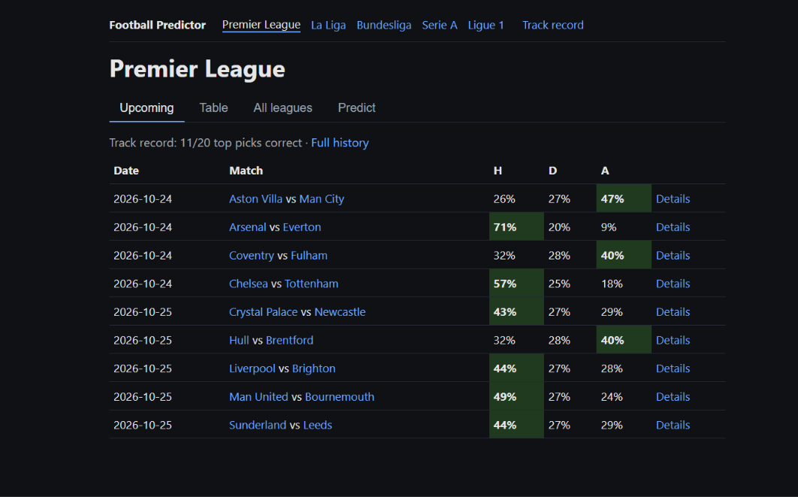

# Football Match Predictor

Live demo: https://wag9.github.io/football-app/

> **Note:** the API runs on a free hosting tier, so the first request after a quiet period can take 30+ seconds while the server wakes up.

An Elo-based Home / Draw / Away probability model for the top five European leagues, with a FastAPI backend, a plain HTML/JS frontend, and a public log of predictions that are written before kickoff and never changed.

This is a research project. The probabilities are not betting advice.

## Results

Walk-forward validation, test seasons 2023/24 to 2025/26 (3 folds). Multiclass log loss, lower is better.

| League | Baseline | Elo only | Elo + shots form | Bookmaker | Gap to bookmaker |
|---|---|---|---|---|---|
| Premier League | 1.0736 | 0.9831 | **0.9776** | 0.9660 | 0.012 |
| La Liga | 1.0654 | 0.9727 | **0.9693** | 0.9555 | 0.014 |
| Bundesliga | 1.0804 | 0.9911 | **0.9856** | 0.9634 | 0.022 |
| Serie A | 1.0915 | 0.9916 | **0.9887** | 0.9667 | 0.022 |
| Ligue 1 | 1.0751 | 1.0080 | **1.0037** | 0.9818 | 0.022 |

- Same configuration in every league (K=30, home advantage 75, promoted-team start 1400), no per-league tuning.
- The shots-on-target feature improved 14 of 15 folds across the five leagues (the one exception was flat).
- All columns were reproduced from the data. The Premier League row uses the 8,591 matches that `main.py` keeps; on all 8,800 matches it is 1.0744 / 0.9826 / 0.9774 / 0.9650 (gap 0.012). The other four leagues use all matches.
- **Caveat:** K, home advantage and the other settings were chosen by looking at these same test folds. The reported scores are therefore a little optimistic. The size of this effect has not been measured.
- The shots feature gain is -0.0042 log loss pooled over the 5,256 test matches (paired SE 0.0011, 95% CI -0.0063 to -0.0021). Per league it is 1.3 to 2.2 standard errors, and no single fold is significant on its own.

## Approach

- Elo ratings are updated match by match. The rating *before* each match is the feature, so nothing leaks from the future.
- Shots feature: rolling mean of (shots on target for minus against) over the last 10 matches, shifted by one match, scaled by 100. Teams with fewer than 3 valid matches get a neutral value of 0, both in training and in prediction.
- Logistic regression on two features: the Elo difference and the shots difference.
- Walk-forward validation by season. Never random splits.
- One Elo state and one prediction log per league.
- Frontend: match preview (probabilities, Elo, recent form, head-to-head, shots form), team pages (Elo rating and rank, season results, Elo history chart, logged predictions), a predictions page, and a track record page.

## What did not help

Tested in [results.md](results.md) and found flat or worse: longer training history, mean reversion of ratings between seasons, margin-of-victory Elo, extra rolling-form features, a draw-specific feature, a Poisson attack/defence model with time decay (avg log loss 0.9929 vs 0.9831 for Elo), and total shots and corners on top of shots on target (0.9774 / 0.9791 vs 0.9776).

## Live prediction log

Predictions are written to `data/predictions_log.csv` (Premier League) and `data/<league>_predictions_log.csv` (the other four leagues) before kickoff, and are never overwritten. Newer rows record when they were made and the kickoff time; a row logged after kickoff is marked as a timing violation and is not scored. Older rows only have a log date and are scored separately as legacy. Results are compared against the bookmaker where odds exist.

## Track record

The site has a [track record page](https://wag9.github.io/football-app/track-record.html) for each league. It shows only predictions that meet all of these rules:

- **Logged before kickoff.** Each prediction has a timestamp, and it must be earlier than the match's kickoff time. Predictions without a timestamp (logged before timestamps were added) are kept in the log but are not part of the track record.
- **Checked against the final result.** A match counts only once its result is in the data. Matches with no result for more than 14 days are treated as postponed and are not scored.
- **Current model only.** Older model versions in the same log are named on the page but not scored.
- **Compared with the bookmaker on the same matches.** Log loss is shown for the model and for bookmaker odds, computed only on matches where both exist.

Sample size matters. Below 30 completed matches, the page shows a warning, because a few results can swing the numbers a lot. At the time of writing, the track record is still too small to draw conclusions, and this section will be updated as results come in.

The same rules are implemented once in `track_record.py` and `evaluation.py`, and both the website and `check.py` use them, so the terminal and the site show the same numbers.

This is a research project, not betting advice.

## Weekly workflow

1. `python weekly.py` downloads the fixtures and the current season's results for all five